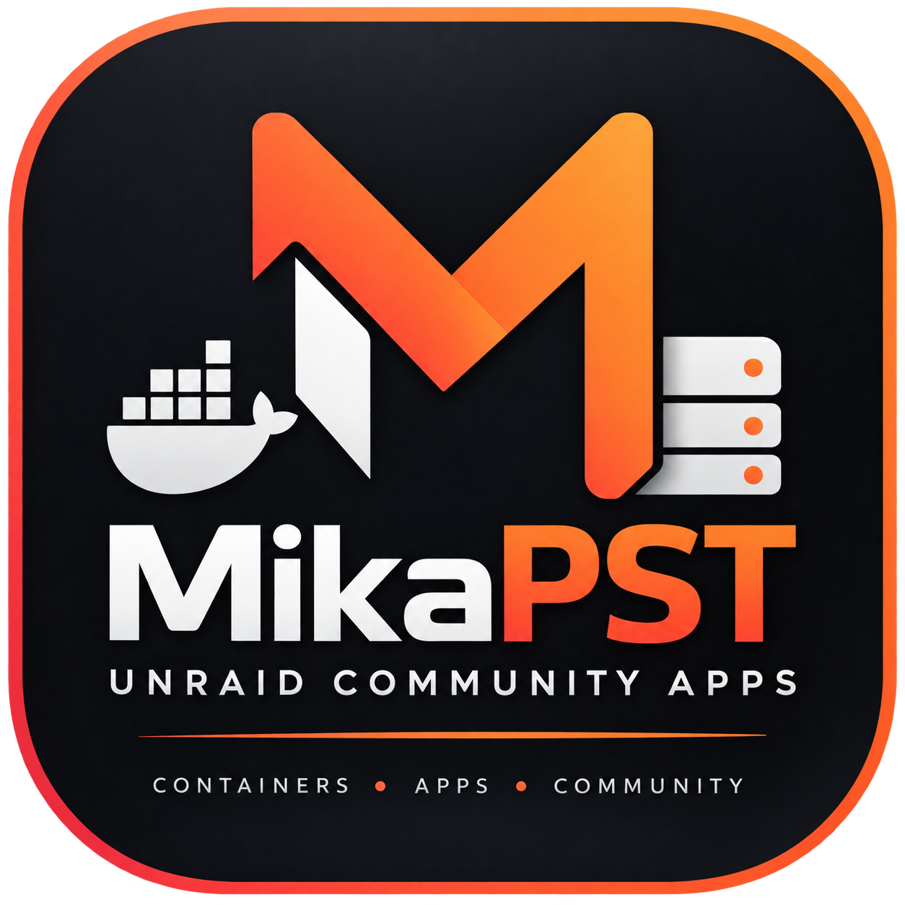
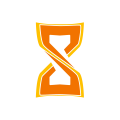
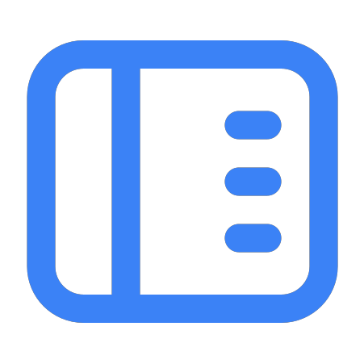
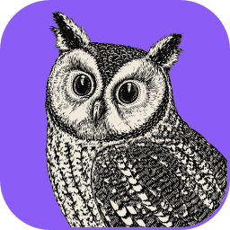

<div align="center">



# MikaPST — Unraid Community Apps

**Docker application templates for Unraid**

[](https://unraid.net/)
[](#applications)
[](https://github.com/MikaPST/unraid-community-apps)
[](https://opensource.org/licenses/MIT)

Self-hosted applications and integrations for the Unraid community.

</div>

---

## About

A curated collection of Docker application templates for **Unraid Community Applications**.

This repository aims to make useful self-hosted tools easier to deploy and maintain on Unraid. Each application has a dedicated guide covering installation, configuration, and useful links. The XML templates stay together in one place, while the documentation is organised separately for easy maintenance.

## Applications

### Sablier



**[Sablier](https://sablierapp.dev/)**  
Docker-aware middleware that can start and stop containers based on incoming requests. It works with reverse proxies such as Traefik to help reduce resource usage when applications are idle.

<div style="clear: left; padding-top: 12px;"><a href="docs/apps/sablier.md"></a>&nbsp;
<a href="templates/sablier.xml"></a>&nbsp;
<a href="compose/sablier.yml"></a></div>
<details>
  <summary><strong>Quick information</strong></summary>

  - **Category:** Docker / FinOps
  - **Docker image:** `sablierapp/sablier:1.18.0`
  - **Default port:** `10000`
  - **Upstream license:** Apache-2.0
</details>

<br clear="all">

### DockDash



**[DockDash](https://github.com/dougmaitelli/DockDash)**  
A Docker dashboard for monitoring containers, resource usage, image updates, health, and GitHub release notes.

<div style="clear: left; padding-top: 12px;"><a href="docs/apps/dockdash.md"></a>&nbsp;
<a href="templates/dockdash.xml"></a>&nbsp;
<a href="compose/dockdash.yml"></a></div>
<details>
  <summary><strong>Quick information</strong></summary>

  - **Category:** Docker / Monitoring
  - **Docker image:** `ghcr.io/dougmaitelli/dockdash:latest`
  - **Container port:** `3001` (Unraid host port defaults to `4001`)
  - **Upstream license:** AGPL-3.0
  - **Security:** Authentication is not enforced by default. Read the dedicated guide before exposing DockDash to a network.
</details>

<br clear="all">

### Portabase Agent


**[Portabase Agent](https://portabase.io/)**  
A background agent that connects Portabase to database servers for configured backup and restore operations. It does not require a web interface or a published web port.

<div style="clear: left; padding-top: 12px;"><a href="docs/apps/portabase-agent.md"></a>&nbsp;
<a href="templates/portabase-agent.xml"></a>&nbsp;
<a href="compose/portabase-agent.yml"></a></div>
<details>
  <summary><strong>Quick information</strong></summary>

  - **Category:** Backup / Database
  - **Docker image:** `portabase/agent:latest`
  - **Web interface:** None
  - **Authentication:** Uses an `EDGE_KEY` generated by the Portabase Dashboard
  - **License:** Refer to the upstream project for the applicable license terms.
</details>

<br clear="all">

### Web-Check


**[Web-Check](https://web-check.xyz/)**  
An open-source OSINT tool for inspecting websites and domains, including DNS records, TLS certificates, HTTP headers, trackers, redirects, and other technical signals.

<div style="clear: left; padding-top: 12px;"><a href="docs/apps/web-check.md"></a>&nbsp;
<a href="templates/web-check.xml"></a>&nbsp;
<a href="compose/web-check.yml"></a></div>
<details>
  <summary><strong>Quick information</strong></summary>

  - **Category:** Security / OSINT
  - **Docker image:** `lissy93/web-check:latest`
  - **Default port:** `3000`
  - **API keys:** Optional for supported third-party integrations
  - **Upstream license:** MIT
</details>

<br clear="all">

### PhotoCraft Web


**[PhotoCraft Web](https://github.com/storytold/photocraft)**  
A browser-based image editor hosted on your own server. This community-maintained Docker image serves PhotoCraft's WebAssembly application through NGINX; image files are opened and exported through your browser rather than stored by the container.

<div style="clear: left; padding-top: 12px;"><a href="https://github.com/MikaPST/photocraft-web/blob/main/README.md"></a>&nbsp;
<a href="templates/photocraft-web.xml"></a>&nbsp;
<a href="https://github.com/MikaPST/photocraft-web/blob/main/docker-compose.yml"></a></div>
<details>
  <summary><strong>Quick information</strong></summary>

  - **Category:** Graphics / Image Editing
  - **Docker image:** `ghcr.io/mikapst/photocraft-web:latest`
  - **Default port:** `8080`
  - **Persistent application volume:** Not required for the standard deployment
  - **Packaging:** Community-maintained by MikaPST; not an official PhotoCraft image
  - **Upstream status:** PhotoCraft is under active development; review the upstream project notes before relying on it for important work
</details>

<br clear="all">

### FilmCraft Web



**[FilmCraft Web](https://github.com/storytold/filmcraft)**  
A browser-based video editor served by a community-maintained Docker image. The container serves FilmCraft's WebAssembly application through NGINX; video editing runs in the browser rather than in a remote desktop environment.

<div style="clear: left; padding-top: 12px;"><a href="https://github.com/MikaPST/filmcraft-web/blob/main/README.md"></a>&nbsp;
<a href="templates/filmcraft-web.xml"></a>
<a href="https://github.com/MikaPST/filmcraft-web/blob/main/docker-compose.yml"></a></div>
<details>
  <summary><strong>Quick information</strong></summary>

  - **Category:** Media / Video Editing
  - **Docker image:** `ghcr.io/mikapst/filmcraft-web:latest`
  - **Container port:** `8080` (Unraid host port defaults to `4444`)
  - **Persistent application volume:** Not required for the standard deployment
  - **Packaging:** Community-maintained by MikaPST; not an official FilmCraft image
</details>

<br clear="all">

### VectorCraft Web


**[VectorCraft Web](https://github.com/storytold/vectorcraft)**  
A browser-based vector graphics editor powered by Rust and WebAssembly. Create and edit vector artwork directly in your browser.

<div style="clear: left; padding-top: 12px;"><a href="https://github.com/MikaPST/vectorcraft-web/blob/main/README.md"></a>&nbsp;
<a href="templates/vectorcraft-web.xml"></a>&nbsp;
<a href="https://github.com/MikaPST/vectorcraft-web/blob/main/docker-compose.yml"></a></div>
<details>
  <summary><strong>Quick information</strong></summary>

  - **Category:** Graphics / Vector Editing
  - **Docker image:** `ghcr.io/mikapst/vectorcraft-web:latest`
  - **Default port:** `8080`
  - **Persistent application volume:** Not required for the standard deployment
  - **Packaging:** Community-maintained by MikaPST; not an official VectorCraft image
  - **Upstream:** [VectorCraft](https://github.com/storytold/vectorcraft)
</details>

<br clear="all">


### LightCraft Web


**[LightCraft Web](https://github.com/storytold/lightcraft)**  
A browser-based image editing application powered by Rust and WebAssembly, served from a lightweight self-hosted Docker image.

<div style="clear: left; padding-top: 12px;"><a href="https://github.com/MikaPST/lightcraft-web/blob/main/README.md"></a>&nbsp;
<a href="templates/lightcraft-web.xml"></a>&nbsp;
<a href="https://github.com/MikaPST/lightcraft-web/blob/main/docker-compose.yml"></a></div>
<details>
  <summary><strong>Quick information</strong></summary>

  - **Category:** Graphics / Image Editing
  - **Docker image:** `ghcr.io/mikapst/lightcraft-web:latest`
  - **Default port:** `8080`
  - **Persistent application volume:** Not required for the standard deployment
  - **Packaging:** Community-maintained by MikaPST; not an official LightCraft image
  - **Upstream:** [LightCraft](https://github.com/storytold/lightcraft)
</details>

<br clear="all">


### PdfCraft Web


**[PdfCraft Web](https://github.com/storytold/pdfcraft)**  
A browser-based PDF application packaged as a static WebAssembly frontend and served through NGINX.

<div style="clear: left; padding-top: 12px;"><a href="https://github.com/MikaPST/pdfcraft-web/blob/main/README.md"></a>&nbsp;
<a href="templates/pdfcraft-web.xml"></a>&nbsp;
<a href="https://github.com/MikaPST/pdfcraft-web/blob/main/docker-compose.yml"></a></div>
<details>
  <summary><strong>Quick information</strong></summary>

  - **Category:** Productivity / PDF
  - **Docker image:** `ghcr.io/mikapst/pdfcraft-web:latest`
  - **Default port:** `8080`
  - **Persistent application volume:** Not required for the standard deployment
  - **Packaging:** Community-maintained by MikaPST; not an official PdfCraft image
  - **Upstream:** [PdfCraft](https://github.com/storytold/pdfcraft)
</details>

<br clear="all">


### EffectCraft Web


**[EffectCraft Web](https://github.com/storytold/effectcraft)**  
A browser-based motion graphics application. Its WebAssembly frontend runs in the browser and uses browser graphics capabilities for editing and rendering.

<div style="clear: left; padding-top: 12px;"><a href="https://github.com/MikaPST/effectcraft-web/blob/main/README.md"></a>&nbsp;
<a href="templates/effectcraft-web.xml"></a>&nbsp;
<a href="https://github.com/MikaPST/effectcraft-web/blob/main/docker-compose.yml"></a></div>
<details>
  <summary><strong>Quick information</strong></summary>

  - **Category:** Media / Motion Graphics
  - **Docker image:** `ghcr.io/mikapst/effectcraft-web:latest`
  - **Default port:** `8080`
  - **Persistent application volume:** Not required for the standard deployment
  - **Packaging:** Community-maintained by MikaPST; not an official EffectCraft image
  - **Upstream:** [EffectCraft](https://github.com/storytold/effectcraft)
</details>

<br clear="all">


### DesignCraft Web


**[DesignCraft Web](https://github.com/storytold/designcraft)**  
A browser-based design application built with Rust and WebAssembly, packaged for self-hosted use.

<div style="clear: left; padding-top: 12px;"><a href="https://github.com/MikaPST/designcraft-web/blob/main/README.md"></a>&nbsp;
<a href="templates/designcraft-web.xml"></a>&nbsp;
<a href="https://github.com/MikaPST/designcraft-web/blob/main/docker-compose.yml"></a></div>
<details>
  <summary><strong>Quick information</strong></summary>

  - **Category:** Graphics / Design
  - **Docker image:** `ghcr.io/mikapst/designcraft-web:latest`
  - **Default port:** `8080`
  - **Persistent application volume:** Not required for the standard deployment
  - **Packaging:** Community-maintained by MikaPST; not an official DesignCraft image
  - **Upstream:** [DesignCraft](https://github.com/storytold/designcraft)
</details>

<br clear="all">


### FigCraft Web


**[FigCraft Web](https://github.com/storytold/figcraft)**  
A browser-based design application packaged as a static WebAssembly frontend and served through NGINX.

<div style="clear: left; padding-top: 12px;"><a href="https://github.com/MikaPST/figcraft-web/blob/main/README.md"></a>&nbsp;
<a href="templates/figcraft-web.xml"></a>&nbsp;
<a href="https://github.com/MikaPST/figcraft-web/blob/main/docker-compose.yml"></a></div>
<details>
  <summary><strong>Quick information</strong></summary>

  - **Category:** Graphics / Design
  - **Docker image:** `ghcr.io/mikapst/figcraft-web:latest`
  - **Default port:** `8080`
  - **Persistent application volume:** Not required for the standard deployment
  - **Packaging:** Community-maintained by MikaPST; not an official FigCraft image
  - **Upstream:** [FigCraft](https://github.com/storytold/figcraft)
</details>

<br clear="all">


### TextureCraft Web


**[TextureCraft Web](https://github.com/storytold/texturecraft)**  
A browser-based texture creation application packaged as a static WebAssembly frontend for self-hosted use.

<div style="clear: left; padding-top: 12px;"><a href="https://github.com/MikaPST/texturecraft-web/blob/main/README.md"></a>&nbsp;
<a href="templates/texturecraft-web.xml"></a>&nbsp;
<a href="https://github.com/MikaPST/texturecraft-web/blob/main/docker-compose.yml"></a></div>
<details>
  <summary><strong>Quick information</strong></summary>

  - **Category:** Graphics / Texturing
  - **Docker image:** `ghcr.io/mikapst/texturecraft-web:latest`
  - **Default port:** `8080`
  - **Persistent application volume:** Not required for the standard deployment
  - **Packaging:** Community-maintained by MikaPST; not an official TextureCraft image
  - **Upstream:** [TextureCraft](https://github.com/storytold/texturecraft)
</details>

<br clear="all">


### MaterialCraft Web


**[MaterialCraft Web](https://github.com/storytold/materialcraft)**  
A browser-based procedural material editor with a node-based workflow and browser graphics rendering.

<div style="clear: left; padding-top: 12px;"><a href="https://github.com/MikaPST/materialcraft-web/blob/main/README.md"></a>&nbsp;
<a href="templates/materialcraft-web.xml"></a>&nbsp;
<a href="https://github.com/MikaPST/materialcraft-web/blob/main/docker-compose.yml"></a></div>
<details>
  <summary><strong>Quick information</strong></summary>

  - **Category:** Graphics / 3D Materials
  - **Docker image:** `ghcr.io/mikapst/materialcraft-web:latest`
  - **Default port:** `8080`
  - **Persistent application volume:** Not required for the standard deployment
  - **Packaging:** Community-maintained by MikaPST; not an official MaterialCraft image
  - **Upstream:** [MaterialCraft](https://github.com/storytold/materialcraft)
</details>

<br clear="all">


### SoundCraft Web


**[SoundCraft Web](https://github.com/storytold/soundcraft)**  
A browser-based digital audio workstation using WebAssembly and Web Audio APIs. Audio processing runs in the browser.

<div style="clear: left; padding-top: 12px;"><a href="https://github.com/MikaPST/soundcraft-web/blob/main/README.md"></a>&nbsp;
<a href="templates/soundcraft-web.xml"></a>&nbsp;
<a href="https://github.com/MikaPST/soundcraft-web/blob/main/docker-compose.yml"></a></div>
<details>
  <summary><strong>Quick information</strong></summary>

  - **Category:** Audio / Music Production
  - **Docker image:** `ghcr.io/mikapst/soundcraft-web:latest`
  - **Default port:** `8080`
  - **Persistent application volume:** Not required for the standard deployment
  - **Packaging:** Community-maintained by MikaPST; not an official SoundCraft image
  - **Upstream:** [SoundCraft](https://github.com/storytold/soundcraft)
</details>

<br clear="all">


### CADCraft Web


**[CADCraft Web](https://github.com/storytold/cadcraft)**  
A browser-based computer-aided design application for creating and editing 2D and 3D CAD projects.

<div style="clear: left; padding-top: 12px;"><a href="https://github.com/MikaPST/cadcraft-web/blob/main/README.md"></a>&nbsp;
<a href="templates/cadcraft-web.xml"></a>&nbsp;
<a href="https://github.com/MikaPST/cadcraft-web/blob/main/docker-compose.yml"></a></div>
<details>
  <summary><strong>Quick information</strong></summary>

  - **Category:** Engineering / CAD
  - **Docker image:** `ghcr.io/mikapst/cadcraft-web:latest`
  - **Default port:** `8080`
  - **Persistent application volume:** Not required for the standard deployment
  - **Packaging:** Community-maintained by MikaPST; not an official CADCraft image
  - **Upstream:** [CADCraft](https://github.com/storytold/cadcraft)
</details>

<br clear="all">


### DeckCraft Web


**[DeckCraft Web](https://github.com/storytold/deckcraft)**  
A browser-based presentation editor for creating and editing slide decks through a WebAssembly application.

<div style="clear: left; padding-top: 12px;"><a href="https://github.com/MikaPST/deckcraft-web/blob/main/README.md"></a>&nbsp;
<a href="templates/deckcraft-web.xml"></a>&nbsp;
<a href="https://github.com/MikaPST/deckcraft-web/blob/main/docker-compose.yml"></a></div>
<details>
  <summary><strong>Quick information</strong></summary>

  - **Category:** Productivity / Presentations
  - **Docker image:** `ghcr.io/mikapst/deckcraft-web:latest`
  - **Default port:** `8080`
  - **Persistent application volume:** Not required for the standard deployment
  - **Packaging:** Community-maintained by MikaPST; not an official DeckCraft image
  - **Upstream:** [DeckCraft](https://github.com/storytold/deckcraft)
</details>

<br clear="all">


### GridCraft Web


**[GridCraft Web](https://github.com/storytold/gridcraft)**  
A browser-based spreadsheet application written in Rust. Workbooks are opened and saved through browser file handling.

<div style="clear: left; padding-top: 12px;"><a href="https://github.com/MikaPST/gridcraft-web/blob/main/README.md"></a>&nbsp;
<a href="templates/gridcraft-web.xml"></a>&nbsp;
<a href="https://github.com/MikaPST/gridcraft-web/blob/main/docker-compose.yml"></a></div>
<details>
  <summary><strong>Quick information</strong></summary>

  - **Category:** Productivity / Spreadsheets
  - **Docker image:** `ghcr.io/mikapst/gridcraft-web:latest`
  - **Default port:** `8080`
  - **Persistent application volume:** Not required for the standard deployment
  - **Packaging:** Community-maintained by MikaPST; not an official GridCraft image
  - **Upstream:** [GridCraft](https://github.com/storytold/gridcraft)
</details>

<br clear="all">


### WordCraft Web


**[WordCraft Web](https://github.com/storytold/wordcraft)**  
A browser-based word processor powered by WebAssembly, with document opening and downloads handled by the browser.

<div style="clear: left; padding-top: 12px;"><a href="https://github.com/MikaPST/wordcraft-web/blob/main/README.md"></a>&nbsp;
<a href="templates/wordcraft-web.xml"></a>&nbsp;
<a href="https://github.com/MikaPST/wordcraft-web/blob/main/docker-compose.yml"></a></div>
<details>
  <summary><strong>Quick information</strong></summary>

  - **Category:** Productivity / Word Processing
  - **Docker image:** `ghcr.io/mikapst/wordcraft-web:latest`
  - **Default port:** `8080`
  - **Persistent application volume:** Not required for the standard deployment
  - **Packaging:** Community-maintained by MikaPST; not an official WordCraft image
  - **Upstream:** [WordCraft](https://github.com/storytold/wordcraft)
</details>

<br clear="all">

## Installation
### Through Unraid Community Applications

1. Open **Apps** in the Unraid web interface.
2. Search for the application by name.
3. Open its listing, review the template settings, and install it.
4. Follow the application's documentation for any additional configuration.

### Using a template XML directly

Each XML template is stored in [`templates/`](templates/). The raw URL for a template follows this pattern:

```text
https://raw.githubusercontent.com/MikaPST/unraid-community-apps/main/templates/sablier.xml
```

Replace `sablier.xml` with the XML file for the application you need.

### Using Docker Compose

Each application also has an example Compose file in [`compose/`](compose/). Review the file and adapt host paths, ports, networks, and environment variables to your setup before starting it.

```bash
docker compose -f compose/web-check.yml up -d
```

For **Portabase Agent**, supply the required `EDGE_KEY` before starting the service. The **Sablier** example expects an existing external Docker network named `traefik`. **DockDash** has access to the Docker socket and does not enforce authentication by default, so do not expose it to an untrusted network without adding an authentication layer.

> These Compose files are deployment examples and complement the Unraid XML templates; they do not replace them.

> **Security note:** Read the application guide before exposing a service outside your local network. Applications with Docker socket access or powerful container-management features require particular care.

## Repository structure

```text
.
├── ca_profile.xml
├── README.md
├── LICENSE
├── icons/
│   ├── icon.png
│   ├── icon-sablier.png
│   ├── icon-dockdash.png
│   ├── icon-portabase.png
│   └── icon-web-check.png
├── templates/
│   ├── sablier.xml
│   ├── dockdash.xml
│   ├── portabase-agent.xml
│   ├── web-check.xml
│   ├── photocraft-web.xml
│   └── filmcraft-web.xml
├── compose/
│   ├── sablier.yml
│   ├── dockdash.yml
│   ├── portabase-agent.yml
│   ├── web-check.yml
│   └── photocraft-web.yml
└── docs/
    └── apps/
        ├── sablier.md
        ├── dockdash.md
        ├── portabase-agent.md
        ├── web-check.md
        └── photocraft-web.md
```

- **`templates/`** — XML templates used by Unraid Community Applications.
- **`docs/apps/`** — dedicated application guides, configuration details, troubleshooting, and upstream links.
- **`compose/`** — example Docker Compose YAML files for users who prefer Compose-based deployments.
- **`icons/`** — the repository logo and application icons.
- **`ca_profile.xml`** — repository profile information used by Community Applications.

The root README is the catalogue and navigation page. Detailed instructions belong in each application's documentation file.

## Support

For issues with an application's features or behaviour, start with the upstream project:

- **Sablier:** [GitHub repository](https://github.com/sablierapp/sablier)
- **DockDash:** [GitHub repository](https://github.com/dougmaitelli/DockDash)
- **Portabase Agent:** [Official website](https://portabase.io/) · [GitHub repository](https://github.com/Portabase/portabase)
- **Web-Check:** [GitHub repository](https://github.com/Lissy93/web-check)
- **PhotoCraft Web:** [MikaPST Docker packaging](https://github.com/MikaPST/photocraft-web) · [Upstream PhotoCraft](https://github.com/storytold/photocraft)
- **FilmCraft Web:** [MikaPST Docker packaging](https://github.com/MikaPST/filmcraft-web) · [Upstream FilmCraft](https://github.com/storytold/filmcraft)
- **VectorCraft Web:** [MikaPST Docker packaging](https://github.com/MikaPST/vectorcraft-web) · [Upstream VectorCraft](https://github.com/storytold/vectorcraft)
- **LightCraft Web:** [MikaPST Docker packaging](https://github.com/MikaPST/lightcraft-web) · [Upstream LightCraft](https://github.com/storytold/lightcraft)
- **PdfCraft Web:** [MikaPST Docker packaging](https://github.com/MikaPST/pdfcraft-web) · [Upstream PdfCraft](https://github.com/storytold/pdfcraft)
- **EffectCraft Web:** [MikaPST Docker packaging](https://github.com/MikaPST/effectcraft-web) · [Upstream EffectCraft](https://github.com/storytold/effectcraft)
- **DesignCraft Web:** [MikaPST Docker packaging](https://github.com/MikaPST/designcraft-web) · [Upstream DesignCraft](https://github.com/storytold/designcraft)
- **FigCraft Web:** [MikaPST Docker packaging](https://github.com/MikaPST/figcraft-web) · [Upstream FigCraft](https://github.com/storytold/figcraft)
- **TextureCraft Web:** [MikaPST Docker packaging](https://github.com/MikaPST/texturecraft-web) · [Upstream TextureCraft](https://github.com/storytold/texturecraft)
- **MaterialCraft Web:** [MikaPST Docker packaging](https://github.com/MikaPST/materialcraft-web) · [Upstream MaterialCraft](https://github.com/storytold/materialcraft)
- **SoundCraft Web:** [MikaPST Docker packaging](https://github.com/MikaPST/soundcraft-web) · [Upstream SoundCraft](https://github.com/storytold/soundcraft)
- **CADCraft Web:** [MikaPST Docker packaging](https://github.com/MikaPST/cadcraft-web) · [Upstream CADCraft](https://github.com/storytold/cadcraft)
- **DeckCraft Web:** [MikaPST Docker packaging](https://github.com/MikaPST/deckcraft-web) · [Upstream DeckCraft](https://github.com/storytold/deckcraft)
- **GridCraft Web:** [MikaPST Docker packaging](https://github.com/MikaPST/gridcraft-web) · [Upstream GridCraft](https://github.com/storytold/gridcraft)
- **WordCraft Web:** [MikaPST Docker packaging](https://github.com/MikaPST/wordcraft-web) · [Upstream WordCraft](https://github.com/storytold/wordcraft)

For issues specific to the Unraid templates maintained in this repository, please [open a GitHub issue](https://github.com/MikaPST/unraid-community-apps/issues).

## Licenses

This repository contains Unraid application templates maintained by MikaPST. Each application remains subject to its own upstream license:

- **Sablier:** Apache License 2.0
- **DockDash:** GNU Affero General Public License v3.0
- **Web-Check:** MIT License
- **PhotoCraft:** the upstream project is dual-licensed under MIT or Apache License 2.0; see its license and attribution files. The MikaPST Docker packaging project and this template repository have their own repository-level license terms.
- **FilmCraft:** refer to the upstream project for its applicable license terms; the MikaPST Docker packaging project and this template repository have their own repository-level license terms.
- **Portabase Agent:** refer to the upstream project for its applicable license terms.

The repository itself is distributed under the license specified in [`LICENSE`](LICENSE).
